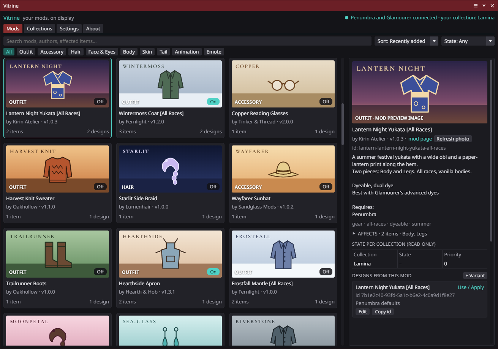
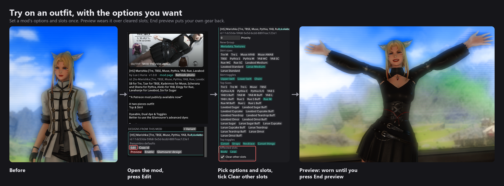
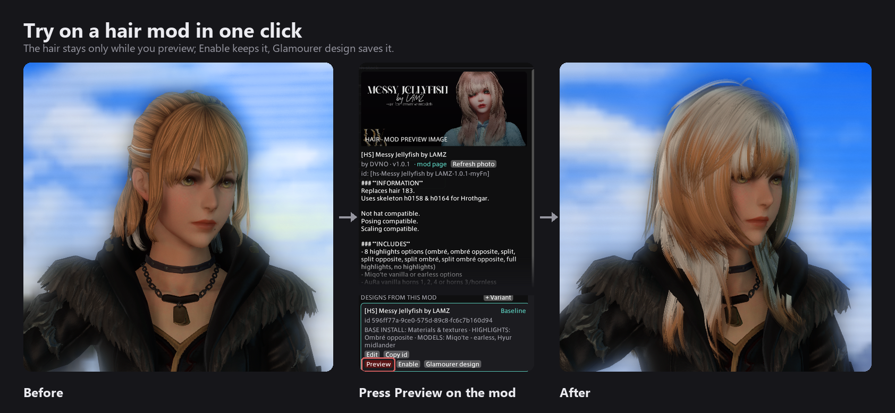
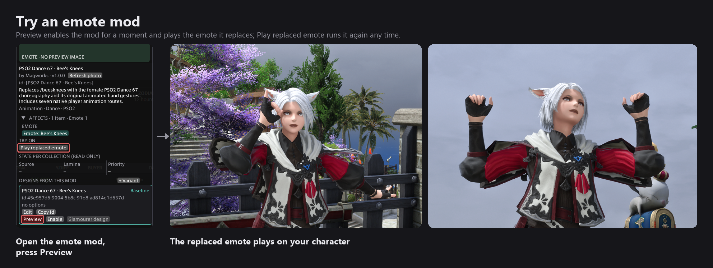

## About
Vitrine is a Dalamud plugin that shows your Penumbra mods the way a shop window would: every mod becomes a card with its display photo, organised by what it changes, and you can try any of them on your character in one click without opening Penumbra or Glamourer.

Dump mods into Penumbra like a mad man; Vitrine keeps them findable.

## Requires
- Penumbra.

## Supports
- Glamourer (equips a mod's gear, applies its hair / face, and receives designs made from a mod).
- Lamina (uses Vitrine designs as layers in its virtual designs, see below).

## Features
- **Mods tab:** a card grid of every mod, classified by category (outfits, accessories, hair, face, body, skin, animations, emotes, VFX, SFX, UI, minions, mounts, housing, NPCs), with search, category chips, sort and an on/off filter.
- **Display photos:** taken from the mod folder when it has one (PNG, JPG or WebP, so Heliosphere covers show), otherwise fetched once from the mod's page (its link-preview image) and cached. A file the game cannot decode is skipped and the next source is tried.
- **Details panel:** author, version, mod page, a collapsible list of what the mod affects (grouped by category; its open state is remembered), its state in your collections, and the designs made from it.
- **Vitrine designs:** every mod gets an auto design with the baseline option settings you choose; variants keep the same mod with different options.
- **Design cards:** every mod has a Baseline card (its settings) and any variants you add; each card has the same buttons.
  - **Preview:** a transient look. Enables the mod on you temporarily (Vitrine's own Penumbra key), equips the card's affected slots through Glamourer, applies hair / face entries that fit your character and plays the replaced emote. One preview at a time; click again, preview another card or close the window and it is gone.
  - **Enable / Disable:** enables the mod in your collection with the card's priority and options, like ticking it in Penumbra, and marks the card active (green). Enabling another card of the same mod switches the settings over.
  - **Glamourer design:** creates a Glamourer design from the card (its pieces, fitting hair / face, and the mod with its settings attached) straight into Glamourer's list.
  - **Edit:** priority, option groups and the **affected slots**: which equipment slots this card equips, and which piece when the mod offers several. Surface level only (the mod still replaces everything Penumbra says it does); it decides what Preview and the Glamourer design equip, and what Lamina layers in. **Clear other slots** empties every gear slot the card does not fill (weapons stay), so an outfit worn before does not bleed through. Click any affected item chip to equip just that piece.

> **Body mods are not enabled for you.** Previewing or enabling an outfit does not switch on the body it was made for (Bibo+, Gen3, TBSE, YAB and so on). A mod's requirements are not listed in the mod itself, so Vitrine cannot know them. If the outfit needs a body your collection does not have enabled, you will see an invisible or broken body: enable the body mod in Penumbra first, then try the outfit.

- **Hair, face, tail and eye mods:** customization entries ("Au Ra Female Hair 194") are chips; the ones made for your race and gender are clickable and switch you to that hairstyle, face or tail through Glamourer, once, unsaved. Entries for other races are greyed out with the reason. Eye packs get an "Eye colour…" picker (right / left / both) so a pack can be judged without opening Glamourer.

- **Collections tab:** read-only overview of your collections, who is assigned to them and how many mods each enables.
- Vitrine never changes your collection assignments or mod folders. Previews are temporary settings and are removed when the window closes or the plugin unloads; only Enable / Disable writes a permanent mod setting, and only into the collection your character uses.

## Important to know
- **Large mod libraries take a while to fill with photos.** A mod with an image in its folder shows it at once. A mod without one gets its photo from its mod page, and those lookups are deliberately slow: at most two run at a time, with a short pause between page fetches, so Heliosphere, XIV Mod Archive and the others are not hammered. With hundreds or thousands of mods that have no local image, expect the "fetching photo" placeholders to keep filling in for a good while after the first open. It happens once: every photo found is cached, and later opens are instant. Mods whose page has no usable image keep their category placeholder.

## Commands
- `/vit` opens or closes the window.
- `/vit rescan` rescans changed mods; `/vit rescan all` rescans everything.
- `/vit clear` removes every preview setting Vitrine wrote.

## Works with Lamina
Vitrine exposes its designs over Dalamud IPC (`docs/IPC.md`): Lamina lists them in its Vitrine Design layer and layers the chosen design's mod settings and pieces into its virtual design, with its own per-layer slot mask so the body of one mod and the boots of another can be combined. Vitrine does not need Lamina, and Lamina works without Vitrine; installing both just connects them.

One of ahadev's plugins. Install through the custom repository `https://raw.githubusercontent.com/AHAKuo/ahadevtools/main/pluginmaster.json`.
